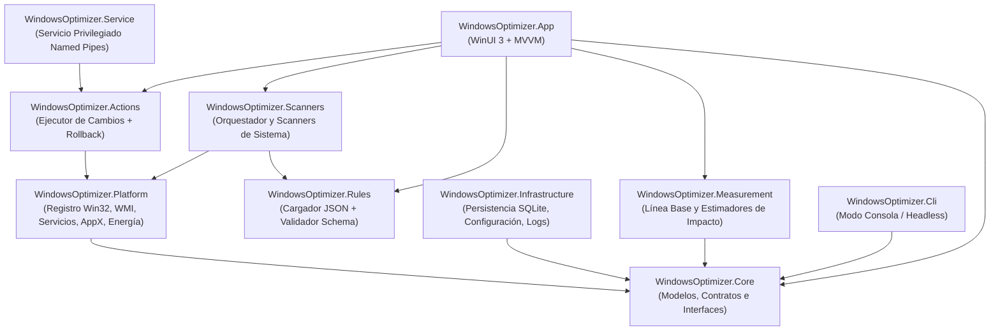

<div align="center">


# Windows Optimizer v1.0

**Analiza · Optimiza · Protege**

[](https://dotnet.microsoft.com/)
[-0078D4?style=for-the-badge&logo=windows11&logoColor=white)](https://learn.microsoft.com/windows/apps/winui/)
[-00A4EF?style=for-the-badge&logo=windows&logoColor=white)](#requisitos-del-sistema)
[](#)

Aplicación nativa de escritorio para Windows diseñada para **auditar el estado del sistema**, **detectar cuellos de botella reales** y **aplicar optimizaciones de forma transparente, segura y 100 % reversible**.

[Características](#-módulos-y-funciones-principales) •
[Principios de Diseño](#-principios-de-diseño) •
[Arquitectura](#-arquitectura-del-proyecto) •
[Motor de Reglas JSON](#-motor-declarativo-de-reglas-data-driven) •
[Compilación y Uso](#-instalación-y-compilación)

</div>

---

## 🎯 ¿Qué es Windows Optimizer?

**Windows Optimizer** nace como una alternativa moderna, rápida y transparente a las utilidades clásicas de mantenimiento, combinando lo mejor de proyectos de referencia de código abierto (**WinUtil**, **privacy.sexy**, **Optimizer**, **Sophia Script** y **BleachBit**) sobre una interfaz nativa **WinUI 3 (Mica / Fluent Design)** sin el peso de Chromium/Electron.

A diferencia de los "optimizadores mágicos", **Windows Optimizer separa el motor de ejecución del conocimiento**: todas las optimizaciones están definidas en catálogos JSON auditables (`rules/*.json`), muestran qué clave del registro, servicio o tarea modifican, calculan una **estimación orientativa de impacto** basada en datos reales del equipo y almacenan una instantánea previa para poder **revertir cualquier cambio individualmente**.

---

## ✨ Principios de Diseño

| Principio | Descripción |
| :--- | :--- |
| 🛡️ **Reversibilidad Total** | Cada cambio guarda el estado original del sistema antes de aplicarse y permite crear puntos de restauración de Windows automáticamente. |
| 🔍 **Transparencia Absoluta** | Cada ajuste explica **qué es**, **por qué importa**, **qué cambia exactamente** y cuál es su nivel de riesgo (`Low`, `Medium`, `High`). |
| 📊 **Estimaciones Honestas** | Basadas en mediciones reales del propio equipo (RAM ocupada, espacio real en disco, latencia ICMP/DNS, impacto en inicio) con indicadores de confianza. |
| ⚡ **100 % Nativo y Ligero** | Construido en C# sobre **.NET 10** y **WinUI 3**. Arranque instantáneo y consumo mínimo de memoria sin navegadores embebidos. |
| 🧩 **Data-Driven (JSON)** | Más de **185 reglas declarativas** organizadas en 12 categorías y validadas mediante **JSON Schema**. |

---

## 🚀 Módulos y Funciones Principales

### 1. 🏠 Dashboard y Diagnóstico en Tiempo Real
- **Panel de Salud del Sistema**: resumen general del estado del equipo, métricas de CPU, RAM, almacenamiento y accesos rápidos de mantenimiento.
- **Diagnóstico *"¿Por qué va lento ahora?"* (`LiveDiagnostic`)**: monitor en vivo que detecta picos anómalos de CPU, procesos con uso excesivo de memoria y cuellos de botella activos con recomendaciones inmediatas.

### 2. ⚡ Rendimiento y Gaming
- **Rendimiento y Planes de Energía (`Performance`)**: activación y gestión de planes de energía de Windows (*Equilibrado*, *Alto Rendimiento*, *Máximo Rendimiento / Ultimate Performance*), hibernación, SysMain, indexación y ajustes de respuesta del sistema.
- **Modo Gaming (`Gaming`)**: optimizaciones específicas para jugadores (Game Mode, desactivación de Game DVR / grabación en segundo plano, aceleración de GPU por hardware HAGS, optimizaciones de pantalla completa y reducción de latencia de entrada).
- **Gestor de Arranque (`Startup`)**: inspección y control de programas de inicio en Registro (`Run`/`RunOnce`) y carpetas de inicio para acelerar el tiempo de arranque.
- **Servicios y Tareas Programadas (`Services`)**: detección de servicios en segundo plano innecesarios y telemetría programada con apagado seguro y reversible.

### 3. 🧹 Limpieza y Espacio en Disco
- **Limpieza de Archivos (`Cleaners`)**: barrido seguro de archivos temporales de Windows (`%TEMP%`, `C:\Windows\Temp`), caché de actualizaciones (`SoftwareDistribution`), miniaturas, registros de eventos antiguos, informes de errores (WER) y caché de navegadores/sistemas.
- **Analizador de Disco (`Disk`)**: inspección rápida de ocupación de espacio, carpetas pesadas y almacenamiento del sistema.
- **Desinstalador de Bloatware (`Apps`)**: catálogo clasificado de aplicaciones preinstaladas (UWP / AppX) que permite eliminar apps innecesarias de forma limpia.

### 4. 🔧 Sistema, Personalización, Privacidad y Red
- **Ajustes de Windows (`SystemTweaks`)**: mejoras de usabilidad del sistema operativo, comportamiento del Explorador de archivos y funciones avanzadas.
- **Personalización Visual (`Ui`)**: ajustes estéticos de Windows 11/10 (menú contextual clásico, barra de tareas, efectos visuales, widgets, Bing en búsqueda, etc.).
- **Privacidad y Telemetría (`Privacy`)**: control granular sobre el envío de datos de diagnóstico, ID de publicidad, seguimiento de actividad, telemetría de aplicaciones y servicios en la nube.
- **Red y Conectividad (`Network`)**: diagnóstico de adaptadores, limpieza de caché DNS (`ipconfig /flushdns`), optimización de pila TCP/IP y selector rápido de servidores DNS de baja latencia (Cloudflare, Google, Quad9, AdGuard).

### 5. 🖥️ Hardware, Drivers e Historial
- **Información del Sistema (`SystemInfo`)**: ficha técnica detallada de CPU, GPU, placa base, memoria RAM, discos (SSD/NVMe/HDD) y sistema operativo mediante consultas WMI/CIM.
- **Drivers y Dispositivos (`Drivers`)**: auditoría de controladores instalados, fechas de compilación, fabricantes y detección de dispositivos con códigos de error en el Administrador de dispositivos.
- **Historial y Rollback (`History`)**: registro cronológico de todas las optimizaciones aplicadas con opción de **restaurar cambios uno a uno o revertir todo el lote**.

---

## 🏗️ Arquitectura del Proyecto

La solución sigue una arquitectura limpia y modular separada por responsabilidades:



### Estructura de Carpetas

```text
WindowsOptimizer/
├── src/
│   ├── WindowsOptimizer.App/            # Interfaz gráfica nativa WinUI 3 (Vistas, ViewModels, Controles, Assets)
│   ├── WindowsOptimizer.Core/           # Entidades de dominio, enums y abstracciones sin dependencias externas
│   ├── WindowsOptimizer.Rules/          # Motor de carga, filtrado por SO/Preset y validación JSON Schema
│   ├── WindowsOptimizer.Platform/       # Implementación real de APIs de Windows (Registro, WMI, Servicios, PowerCfg, AppX)
│   ├── WindowsOptimizer.Scanners/       # Scanners de solo lectura para auditar el sistema sin modificarlo
│   ├── WindowsOptimizer.Measurement/    # Recolección de línea base y cálculo de estimaciones de impacto
│   ├── WindowsOptimizer.Actions/        # Ejecución transaccional de reglas, puntos de restauración y rollback
│   ├── WindowsOptimizer.Infrastructure/ # Almacenamiento local SQLite, historial y configuración
│   ├── WindowsOptimizer.Service/        # Servicio de Windows para operaciones privilegiadas por Named Pipes
│   └── WindowsOptimizer.Cli/            # Interfaz de línea de comandos para automatización
├── rules/                               # Catálogo declarativo de reglas (.json) y esquema de validación
│   ├── schema/rule.schema.json          # Esquema JSON estricto validado en pruebas
│   ├── cleaners.json                    # Reglas de limpieza de temporales y cachés
│   ├── gaming.json                      # Optimizaciones para juegos y baja latencia
│   ├── network.json                     # Ajustes de red y DNS
│   ├── performance.json                 # Planes de energía y rendimiento del sistema
│   ├── privacy.json                     # Desactivación de telemetría y rastreo
│   ├── services.json                    # Optimización de servicios de Windows
│   ├── scheduled-tasks.json             # Tareas programadas innecesarias
│   ├── startup.json                     # Gestión de elementos de inicio
│   ├── system.json                      # Ajustes generales de Windows
│   ├── ui.json                          # Personalización de interfaz de Windows 10/11
│   ├── apps.json                        # Catálogo de aplicaciones preinstaladas (Bloatware)
│   └── presets.json                     # Perfiles Minimal, Standard y Advanced
├── tests/                               # Suite completa de pruebas unitarias (xUnit)
└── docs/                                # Documentación de arquitectura, catálogo y decisiones técnicas
```

---

## 📜 Motor Declarativo de Reglas (Data-Driven)

Cada regla del catálogo (`rules/*.json`) es un documento JSON autocontenido que define cómo detectar el problema, cómo solucionarlo, cómo explicarlo al usuario y cómo revertirlo:

```json
{
  "id": "privacy.disable-advertising-id",
  "name": "Desactivar ID de publicidad de Windows",
  "category": "privacy",
  "risk": "low",
  "presets": ["minimal", "standard", "advanced"],
  "windows": {
    "min_build": 17763,
    "editions": ["Home", "Pro", "Enterprise"]
  },
  "detect": {
    "registry": {
      "path": "HKCU\\Software\\Microsoft\\Windows\\CurrentVersion\\AdvertisingInfo",
      "name": "Enabled",
      "bad_value": 1
    }
  },
  "apply": [
    {
      "type": "registry_set",
      "path": "HKCU\\Software\\Microsoft\\Windows\\CurrentVersion\\AdvertisingInfo",
      "name": "Enabled",
      "value": 0,
      "kind": "DWord"
    }
  ],
  "undo": "auto_from_snapshot",
  "reversible": true,
  "requires_admin": false,
  "requires_reboot": false,
  "explain": {
    "what": "Identificador único que Windows asigna para mostrar anuncios personalizados.",
    "why": "Evita el perfilado publicitario entre aplicaciones.",
    "changes": "Establece HKCU\\...\\AdvertisingInfo\\Enabled = 0."
  }
}
```

---

## 🛠️ Requisitos del Sistema

- **Sistema Operativo**: Windows 10 (versión 1809 / Build 17763 o superior) o Windows 11 (x64).
- **Para compilar desde el código fuente**:
  - [.NET 10 SDK](https://dotnet.microsoft.com/download/dotnet/10.0)
  - Windows App SDK / Carga de trabajo de desarrollo de escritorio con .NET y WinUI.

---

## 💻 Instalación y Compilación

### Clonar el repositorio

```bash
git clone https://github.com/BrandonMieres/WindowsOptimizer.git
cd WindowsOptimizer
```

### Compilar y ejecutar pruebas

```powershell
# Ejecutar toda la batería de pruebas unitarias y validación de reglas JSON
dotnet test -c Release

# Compilar la aplicación de escritorio (x64)
dotnet build src/WindowsOptimizer.App/WindowsOptimizer.App.csproj -c Release -p:Platform=x64
```

### Generar versión portable lista para distribución (Self-Contained)

```powershell
dotnet publish src/WindowsOptimizer.App/WindowsOptimizer.App.csproj -c Release -p:Platform=x64 -p:PublishProfile=win-x64.pubxml
```

El ejecutable autocontenido (`WindowsOptimizer.App.exe`) junto con sus reglas y recursos se generará en:
`src/WindowsOptimizer.App/bin/Release/net10.0-windows10.0.26100.0/win-x64/publish/`

---

## 📚 Documentación Adicional

- 📖 [**Especificación del Proyecto (`docs/PROYECTO.md`)**](docs/PROYECTO.md)
- 🗂️ [**Catálogo de Optimizaciones (`docs/CATALOGO_OPTIMIZACIONES.md`)**](docs/CATALOGO_OPTIMIZACIONES.md)
- 🛣️ [**Hoja de Ruta del Motor (`docs/ROADMAP_MOTOR.md`)**](docs/ROADMAP_MOTOR.md)

---

<div align="center">
Desarrollado con ❤️ usando <b>C# · .NET 10 · WinUI 3</b>
</div>
